# meshcore-tui

[](https://github.com/verdantran/meshcore-tui/releases/latest)

A terminal client for [MeshCore](https://meshcore.io) radios: chats, contacts, a map of the mesh drawn in braille, a live packet inspector, and remote administration of repeaters and room servers. It connects over USB serial, Bluetooth or WiFi, runs happily over SSH and in tmux, and ships as a single binary.

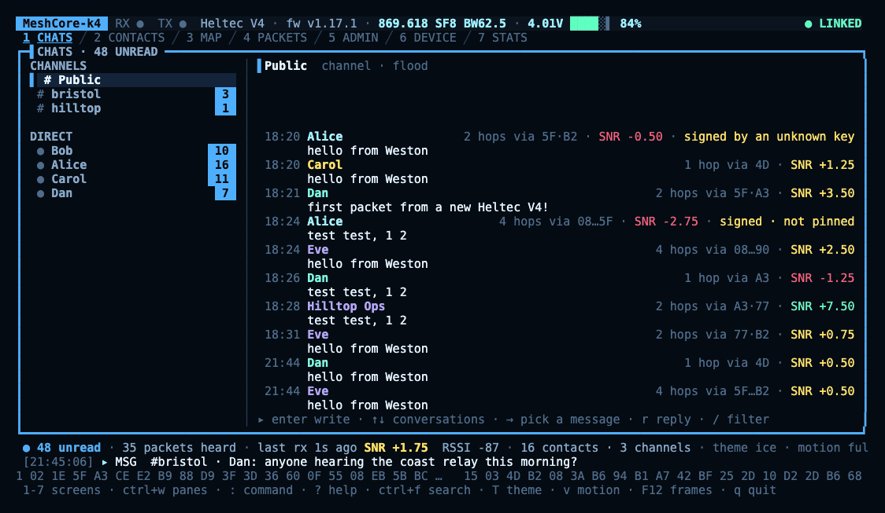

The recording and screenshots here all come from `--demo`, a simulated mesh with made-up nodes, so you can try the app without a radio. They use the `ice` theme.

## Screens

**1 Chats.** Channels and direct messages, with unread counts, delivery state (sent, heard repeating, delivered), hops and signal on every message, and replies. Incoming DMs and mentions show as toasts, and can ring the bell or raise a desktop notification; `m` mutes a busy conversation. To join a channel, pick **+ add a channel** under the channels (or press `n`): a `#name` joins a public hashtag channel, and a private one takes its secret or a shared link. Picking a message that mentions a `#channel` you're not in offers `J` to join it. Channel messages can be signed, so someone posting under another person's name stands out; this is experimental, as [docs/signing.md](docs/signing.md) explains.

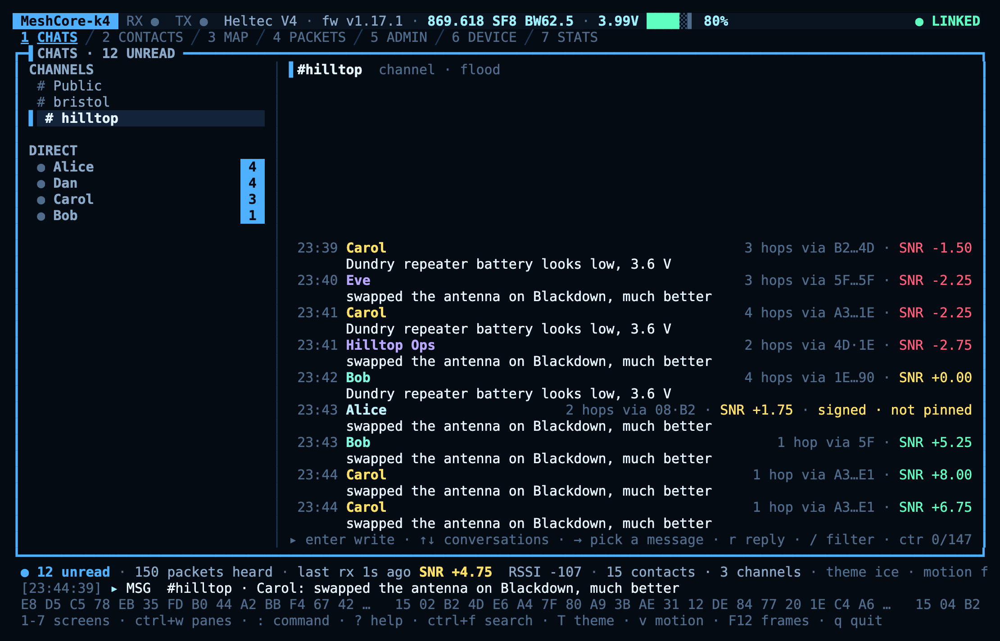

**2 Contacts.** Everyone your radio knows, sortable and filterable, with each contact's key, location, route and advert path. From here you can message, trace, discover or set a route, pin a signing key, share a contact as a QR code or link, and import one.

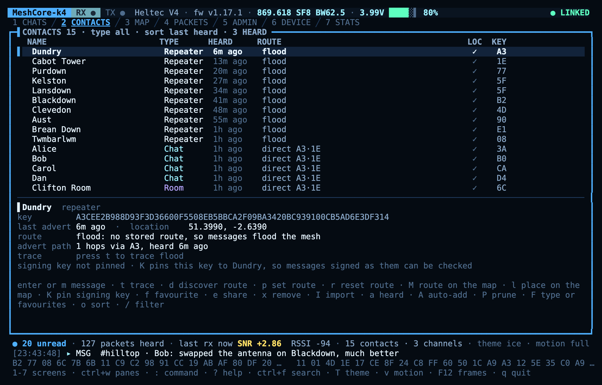

**3 Map.** Nodes placed where they advertise, and the routes packets actually took, hop by hop. Traffic animates across the map as it's heard, and the busiest links stay drawn; `f` picks out one node's links at a time, and `space` switches kinds of node, routes and layers off when it gets busy. The world map is built in and works offline; street detail for your area can be downloaded from OpenFreeMap with one key press.

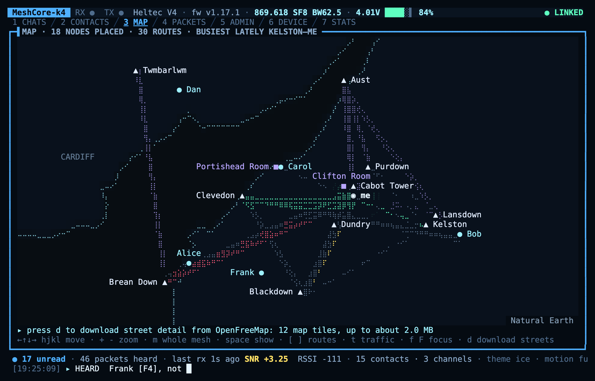

**4 Packets.** What the radio hears on the open mesh, decoded: route, type, hops, path, signal and how many copies arrived. Select a packet to step through its fields, with each field's bytes highlighted in the hex dump. It shows adverts and messages on channels anyone can join (Public and hashtag channels); other people's direct messages and private channels are only counted, never shown.

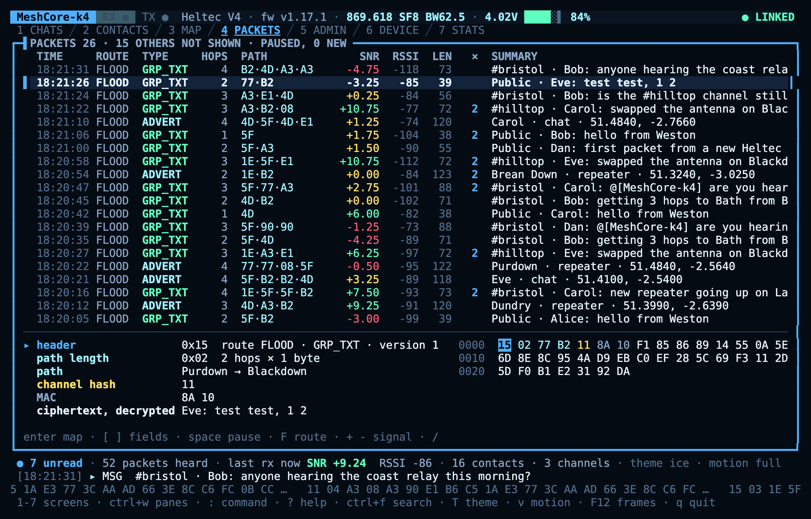

**5 Admin.** Log in to repeaters and room servers over the mesh for status, health history, every setting, neighbours, access lists, regions, telemetry, the log and a raw console. A fleet view and a watch list keep an eye on several nodes at once. A repeater plugged in by USB opens straight onto its console with `--repeater`.

**6 Device.** Your own radio's settings, and [backing it up](docs/backup.md) to a file you can restore later, choosing what goes in: name and location, radio presets, TX power, tuning, telemetry sharing, BLE PIN, clock sync, key export and import, reboot and factory reset. Changes go to the radio as soon as you enter them.

**7 Stats.** Uptime, battery, noise floor, airtime and packet counters with sparklines, and an overview of the mesh from what you've heard: busiest repeaters, hop counts, signal spread and channel activity.

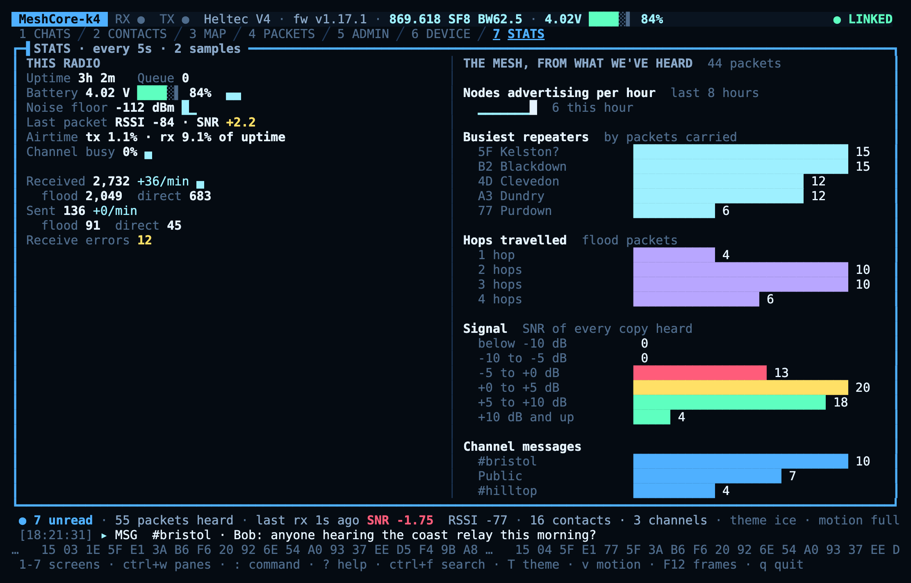

### Several at once

Any screens can share the view, split side by side or stacked as in tmux: `ctrl+w` then `v` or `s`, arrows to move between them, `ctrl+w q` to close one. Each keeps working while it's on show, so you can read a channel while its packets cross the map. The layout is remembered.

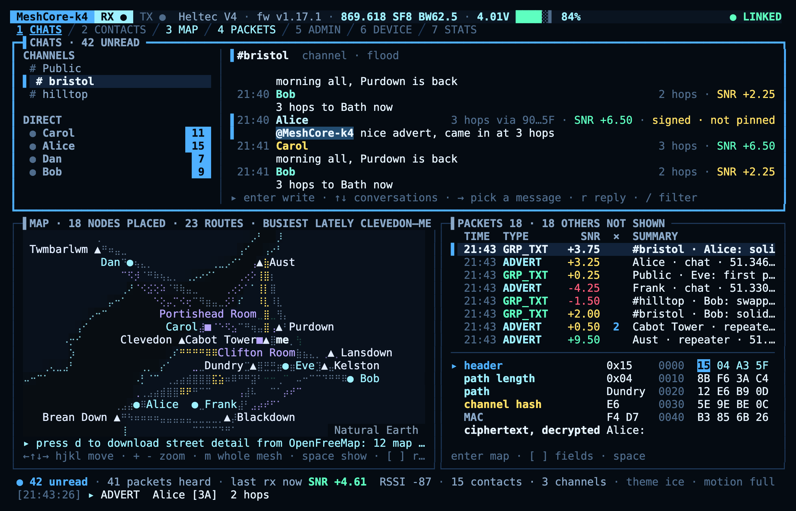

## Install

### From a release

Each [release](https://github.com/verdantran/meshcore-tui/releases/latest) has a single binary for each platform, with nothing else to install:

| Platform | File |
|---|---|
| macOS, Apple silicon | `meshcore-tui_macos_arm64.tar.gz` |
| macOS, Intel | `meshcore-tui_macos_amd64.tar.gz` |
| Linux, x86-64 | `meshcore-tui_linux_amd64.tar.gz` |
| Linux, 64-bit ARM (Raspberry Pi 3 and later on a 64-bit OS) | `meshcore-tui_linux_arm64.tar.gz` |
| Linux, 32-bit ARM (Raspberry Pi OS 32-bit) | `meshcore-tui_linux_armv7.tar.gz` |
| Windows, x86-64 | `meshcore-tui_windows_amd64.zip` |
| Windows, ARM | `meshcore-tui_windows_arm64.zip` |

On macOS or Linux, download and install one in a single go, picking your file from the table:

```sh
curl -fsSL https://github.com/verdantran/meshcore-tui/releases/latest/download/meshcore-tui_linux_amd64.tar.gz | tar -xz
sudo install meshcore-tui/meshcore-tui /usr/local/bin/
```

That always fetches the newest release; for a particular one, use `releases/download/v0.1.0/…` in place of `releases/latest/download/…`. Or put it in `~/.local/bin` instead of `/usr/local/bin` to skip `sudo`. On Windows, unzip it and run `meshcore-tui.exe` from Windows Terminal.

To check a download before unpacking it, fetch the archive and `SHA256SUMS` from the release into one folder and run `shasum -a 256 -c SHA256SUMS --ignore-missing`.

The binaries aren't signed. macOS only objects to one downloaded through a browser; if it says the app can't be opened, run `xattr -d com.apple.quarantine meshcore-tui` once. Windows SmartScreen may warn the first time too: **More info**, then **Run anyway**.

On a Mac, the first launch asks for Bluetooth, even if you only connect over USB or WiFi: the Bluetooth library sets itself up as the app starts, and macOS asks then. Saying no only turns off Bluetooth radios; everything else works, and you can change your mind in System Settings → Privacy & Security → Bluetooth.

On Linux, serial ports belong to a group, usually `dialout` (`uucp` on Arch). If a radio on USB says permission denied, add yourself with `sudo usermod -aG dialout $USER` and log in again.

### From source

You need Go 1.26.10 or later. On a Mac, the build needs cgo for listing serial ports and for Bluetooth, which works out of the box once the Xcode command line tools are installed.

```sh
go install github.com/verdantran/meshcore-tui/cmd/meshcore-tui@latest
```

Or from a checkout:

```sh
git clone https://github.com/verdantran/meshcore-tui
cd meshcore-tui
go build -trimpath -o meshcore-tui ./cmd/meshcore-tui
```

`-trimpath` keeps your own folder names out of the binary. Linux and Windows builds are fully static and can be cross-compiled from anywhere with `CGO_ENABLED=0 GOOS=linux go build -trimpath ./cmd/meshcore-tui`.

`meshcore-tui --version` says which release or commit a binary was built from; in the app it shows under the logo, in the help title and on `:version`.

## Connecting

Run `meshcore-tui` on its own to open the connect screen. It lists your saved devices first, then likely radios among the serial ports. Press `b` to scan for Bluetooth radios, or enter a TCP address for a WiFi companion. Devices are saved once connected, and one can be set to connect automatically.

You can also connect straight away:

```sh
meshcore-tui --serial /dev/cu.usbmodem1101    # or /dev/ttyACM0, or COM3
meshcore-tui --ble AA:BB:CC:DD:EE:FF          # as the connect screen's scan shows it; a UUID on macOS
meshcore-tui --tcp 192.168.1.40               # port 5000 unless you give one
meshcore-tui --serial /dev/ttyUSB0 --repeater # a repeater's own console
meshcore-tui --demo                           # a simulated mesh
```

Heltec V4 radios ship separate firmware for USB, Bluetooth and WiFi companions. If a connection fails in a way that suggests the wrong build, the app says so.

Over Bluetooth, the radio must be paired before it takes commands, with the PIN on its screen, or `123456` if it has no screen, unless you've set your own. On Linux, BlueZ has no agent to ask for it, so pair once with `bluetoothctl` first; on Windows, pair once in Windows Settings (Win+I) → Bluetooth & devices → Add device.

## Getting around

| Key | Does |
|---|---|
| `1`–`7` | Switch screens (`tab` and `shift+tab` too) |
| `j` `k`, arrows, `g` `G` | Move in lists, and jump to the top or bottom |
| `enter`, `esc` | Act on the selected row, and back out one level |
| `/` | Filter |
| `:` or `ctrl+k` | Go anywhere: type part of any screen, chat, contact, repeater, command or theme and press `enter`. Commands run as typed: `:msg Bob hello`, `:trace Dundry`, `:mute 8h` |
| `ctrl+f` | Search messages |
| `ctrl+w` then `v` or `s` | Split the screen side by side or stacked, as in tmux |
| `T` | Cycle themes |
| `v` | Cycle motion: full, reduced, off |
| `?` | Every key on the current screen |
| `q` | Quit |

Letters keep their meaning from screen to screen: `y` copies, `e` shares, `x` removes (after asking), `u` refreshes, `n` adds, `o` sorts, `F` cycles a quick filter, `M` shows something on the map and `L` logs in or out. Anything that deletes data or changes another node asks for `y` first, and rebooting or replacing an identity has you type a word.

The mouse works too: click a screen's name to go to it, or a pane to focus it, and the wheel scrolls.

Any key can be rebound in `keys.toml`, apart from `ctrl+c` and what you type into a text field; see [Configuration](docs/configuration.md#keys).

## Looks

The default theme is `neon`. There are twelve others: `dusk`, `vapor`, `ice`, `midnight`, `ember`, `amber`, `toxic`, `phosphor`, `light`, `paper`, `high-contrast`, and `mono`, which is used automatically when `NO_COLOR` is set. Choose one with `--theme`, in the config file, or with `T` as you go.

Each theme is the same thirteen colours, so every screen works in all of them:

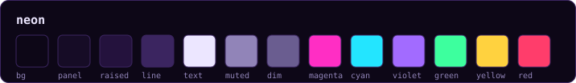
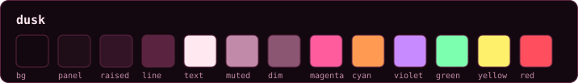
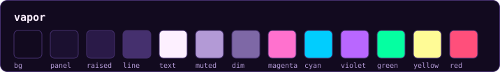
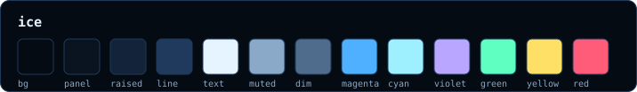
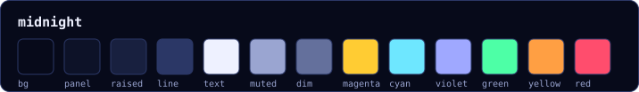
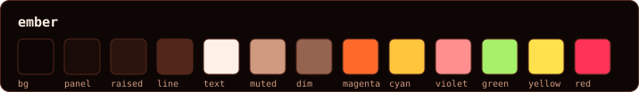
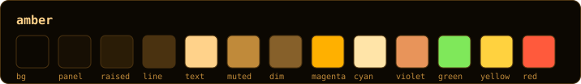
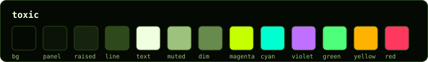
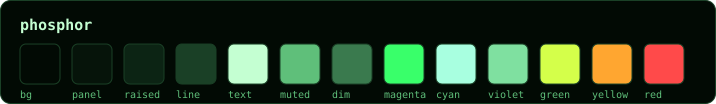
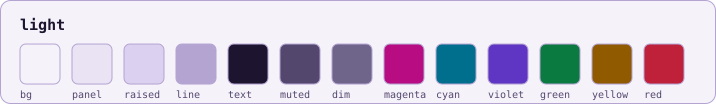
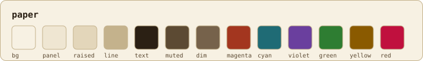
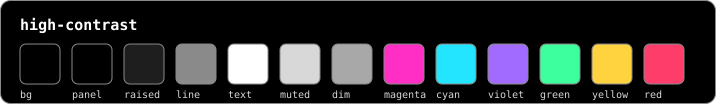
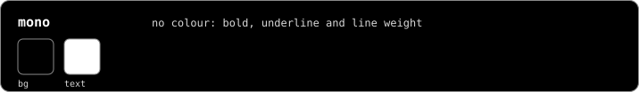

`go run ./scripts/swatches` redraws these from the themes themselves.

The app animates every event the radio reports. Motion drops to `reduced` over SSH or mosh, tmux attached over SSH included, and `--motion off` stills it entirely. For terminals without braille or box drawing, `--ascii` redraws everything in plain ASCII and keeps the colours.

A truecolor terminal looks best. Ghostty, iTerm2, kitty, WezTerm, Alacritty and Windows Terminal all work. On Windows, the old console host can't draw braille or some symbols, so use Windows Terminal.

## Configuration

Settings live in `~/.config/meshcore-tui/config.toml`, and data (message history, contacts, watched nodes' status, map detail and exports) in `~/.local/share/meshcore-tui/`, readable only by you. On Windows they're in `%APPDATA%\meshcore-tui\` and `%LOCALAPPDATA%\meshcore-tui\`. Repeater passwords go in the OS keychain, or in `passwords.json` beside the config where there isn't one, and are only ever sent to a radio that has proved it's yours. [docs/privacy.md](docs/privacy.md) says what's kept and for how long.

The file is optional; everything has a default. [docs/configuration.md](docs/configuration.md) covers every setting.

## Built with AI

Most of meshcore-tui was written with Claude, Anthropic's AI model. It's had security and performance reviews, but not an independent audit, so do your own due diligence before relying on it; [AI_DISCLOSURE.md](AI_DISCLOSURE.md) says what was checked and what wasn't.

## Thanks

meshcore-tui stands on [meshcore-go](https://github.com/OwlShack/meshcore-go), OwlShack's Go port of MeshCore. It does the hard part, from the companion protocol and packet decoding to the cryptography, and without all that careful work this app wouldn't exist. Thank you.

Thanks also to the [MeshCore](https://github.com/meshcore-dev/MeshCore) project and everyone running nodes on the mesh.

## Licence

MIT; see [LICENSE](LICENSE). The app is built on [meshcore-go](https://github.com/OwlShack/meshcore-go) and [Charm](https://charm.land)'s Bubble Tea and Lip Gloss. [THIRD_PARTY_NOTICES](THIRD_PARTY_NOTICES) lists the licences of everything compiled in, and the map data's sources: Natural Earth for the built-in world map, and OpenFreeMap, OpenMapTiles and OpenStreetMap for downloaded street detail.
